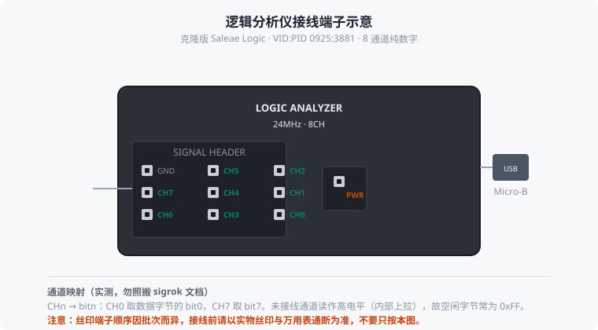

# 几十块的逻辑分析仪，自己写上位机

**Cypress FX2 · 8 通道 · 24 MHz —— 一份参考实现，不是成品**

> 这是一个**个人学习项目**，不是可用产品。功能并不完善，代码只保证「在我这一块板子上跑通过」。
> 它的价值在于**展示一条可行的技术方向**：几十块钱的逻辑分析仪，也可以有自己写的上位机。
> 请把它当作**参考资料**阅读，不要当作生产工具使用：这是参考实现，不完善，不承诺可用性。
> 免责声明贯穿全文并在文末集中列出，请在开始前先把它读完。

## ⚠️ 先说清楚：这不是成品

这份仓库记录的是一次逆向学习与自研上位机的尝试。它不是产品，没有交付承诺，也没有维护承诺。下面把边界摊开说。

### 能做什么（均为作者本机实测，他人环境未验证）

| 项目 | 我实现过的情况（仅限作者本机的这一块板子） |
|---|---|
| 采样率 | 200 kHz ~ 24 MHz 共 10 档，逐档实测满速；他人环境未验证 |
| 通道 | 8 路纯数字通道，作者本机接线实测；他人环境未验证 |
| 波形显示 | 缩放、平移、光标、时间轴（ns~s 自动切换），作者本机跑通 |
| 协议解码 | UART / I2C / SPI / CAN 四种，用合成数据在作者环境验证过 |
| 测量 | 频率、占空比、边沿数、脉宽，作者本机跑通 |
| 触发 | 软件触发（边沿/电平/脉宽/模式/串口起始位），作者本机跑通 |
| 导出 | CSV / VCD / 二进制，作者本机跑通 |
| 界面 | 中文网页版，作者本机启动过 |

### 做不到什么（明确的天花板，别在这里浪费时间）

| 做不到 | 原因 |
|---|---|
| 硬件触发 | 设备的触发寄存器协议没有逆出来；已知同类方案里的触发也是软件做的 |
| 模拟通道 | 这块板子没有 ADC，是纯数字 8 通道 |
| 超过 8 通道 | 硬件规格限制 |
| 超过 24 MHz | FX2 High Speed 带宽上限 |
| 原厂 Socket API | 端口 10429 实测只收不回（收到 702 个事件，服务端 0 字节发出） |
| `.logicdata` 原生格式导出 | 没有实现，目前只有 CSV / VCD / 二进制三种 |

### 已知缺陷（技术债清单，按交接手册如实列出）

| 缺陷 | 现状与影响 |
|---|---|
| 前端无模块系统 | 单文件 1152 行 IIFE，靠全局对象暴露；大改动影响面大 |
| 采样率下拉缓存守卫 | 靠 `data-sig` 比对才重建下拉，无条件重建会冲掉用户选择（踩过） |
| 设备占用分支 | 状态刷新里三处分支，前后端文案要两处同步，最容易出问题 |
| `signal_present` 误报 | 只看相邻字节是否不同，CH0 未接线会误报「未检测到信号」 |
| 事件行上限 500 | 超出只提示不渲染，长采集丢显示但不丢数据 |
| 采集窗口裁剪口径 | 按 `hz*seconds` 裁剪多读的残留，达成率分母必须用 `seconds` |
| 旧版 GUI 与网页版逻辑重复 | 两套界面各自保留完整实现，改业务逻辑要两边都考虑 |
| 解码分派单点 | 集中在一处 if/elif 链，新增协议要在这里插分支 |

把上面三张表连起来看：这是一份参考材料，不是一个完整工具。自动化测试 7 个套件共 **71 个用例**，在设备就绪、且 50 kHz 方波接在 CH0 的条件下全部通过。

> **复现前提**：其中 4 个套件（`test_core`、`test_trigger`、`test_server` 与部分采集用例）需要真实设备在位；`test_core` / `test_trigger` 里的波形用例还假设信号接在 **CH0**。设备未初始化或信号接在别的通道时，这些用例会失败——这是环境问题，不是代码缺陷。其余纯算法与渲染用例（解码器、导出、降采样）无需硬件。

## 这个项目想分享什么

**我们想分享的是技术行为本身——你可以根据自己的需求，制作这款淘宝逻辑分析仪的上位机。**

换句话说，重点不是这套代码能跑多远，而是「这件事可以被做出来」的过程。分为四点：

1. **方法论可复用**：逆向思路是熵分析 → 内存 dump → 字符串情报 → 反汇编定位。这条链路与具体设备无关，换一块板子也能照着走一遍。
2. **协议事实可复用**：采样率对应的 delay 公式（`48000000 / rate - 1`）、USB 端点布局（命令 OUT 0x01、应答 IN 0x81、数据 IN 0x82）、通道位序（`CHn → bitn`），这些是查证过的硬事实，可直接引用。
3. **代码可参考**：采集、解码、渲染三层是分开的，目录也是按这个边界切的。你可以只借其中一层的结构，不必整仓搬走。
4. **坑可避**：证伪清单记下了哪些路走不通——硬件触发、模拟通道、原厂 Socket API、汉化原厂程序等，避免重复踩坑。

再次强调：以上四点都是**参考**，不是交钥匙方案。你需要根据自己的需求重新取舍、重新验证。

## 硬件与前提



> 示意图，非实物照片。**丝印顺序因批次而异，接线前请以实物丝印与万用表通断为准。**

| 项目 | 事实 |
|---|---|
| 设备型号 | 克隆版 Saleae Logic 逻辑分析仪，VID:PID `0925:3881` |
| 主控芯片 | Cypress FX2 CY7C68013 |
| 通道数 | 8 路纯数字（无模拟通道） |
| 最高采样率 | 24 MHz（10 档：200 kHz ~ 24 MHz） |
| 连接方式 | USB High Speed，WinUSB 免驱方式访问 |
| 通道映射 | **CHn → bitn**（CH0 取 bit0）。与 sigrok 文档记载相反，本项目按实测实现 |

> **注意**：**必须先运行一次原厂软件完成初始化**，否则数据端点不存在，本项目代码读不到任何数据。**本项目不包含、不分发原厂软件。**初始化这一步需要使用者自己合法完成，本文不提供任何获取渠道或指引。

这一点是整份材料里最容易踩的坑，也是反复声明的边界之一：硬件前提不满足时，后面所有内容都不成立。

## 目录结构

只列发布副本里真实存在的目录，每个目录一行注释：

```
发布副本/
├── docs/            配图（引脚示意 SVG）
├── 交接手册/        7 篇完整文档（总入口在最前面）
├── 03_host/         WinUSB ctypes 封装（零第三方依赖）
├── 08_fx2/          采集实现（唯一验证可用）
├── 09_app/          协议解码器 + 导出
├── 12_trigger/      软件触发引擎
├── 13_web/          网页版上位机（主产品）
├── 10_gui/          早期 tkinter 界面（备用）
├── 11_pack/         旧版打包脚本（备用）
├── 14_research/     10 份业界调研
├── 逆向方法论/      逆向过程的分析结论
├── 已证伪路线/      走不通的路及其原因
├── 00_notes/        公开资料调研
└── 01_sdk/          Analyzer SDK ABI 复原
```

上述目录仅供阅读与参照，不保证在任何机器上都能直接运行。

## 快速验证（如果非要试）

以下步骤假设你已经自己搞定了原厂软件初始化。没搞定的话，后面全部会失败。
命令中的路径均为相对路径，请先进入发布副本根目录再执行。

**第 1 步：设备在不在**

```bash
powershell -NoProfile -Command "Get-PnpDevice -PresentOnly | Where-Object {$_.InstanceId -match '0925'} | Format-Table Status,FriendlyName,InstanceId -AutoSize"
```

预期看到：`Status=OK`，设备名 `Saleae Logic USB Logic Analyzer`，硬件 ID 含 `VID_0925&PID_3881`。

**第 2 步：端点对不对**

```bash
cd 03_host
python -I -c "import sys;sys.path.insert(0,'.');import winusb;d=winusb.SaleaeDevice(winusb.enumerate_devices()[0]['path']);d.open();print('alt=',d.alt_setting);print([hex(p) for p,t,m,i in d.list_pipes()])"
```

预期看到：`alt= 0`，端点列表里含 `0x82`。如果是 `alt= 1` 且没有 `0x82`，说明初始化没做，回到前提那一节。

**第 3 步：能不能采集**

```bash
cd ../08_fx2
python -I capture_verified.py --rate 1000000 --seconds 0.5 --freq --out /tmp/check.bin
```

预期看到：`captured` 后面是 50 万附近的数字，不一定是精确 500000（命令行直跑会多读到一点上轮残留，可能到 50~52 万），文件写到 `/tmp/check.bin`。

**第 4 步：界面能不能开**

```bash
cd ../13_web
```

双击 `dist_app/LogicWeb.exe`，浏览器自动打开，徽章显示绿色「设备就绪」。

再次说明：这几步是我这边的记录，不是对你环境的承诺；任何一步失败都不意外，请参考免责声明。

## 免责声明

这一节是重点，请逐条读完。它比前面所有章节加起来都更谨慎，因为本项目的定位就是「参考资料」而非可用工具。

1. 本项目为个人学习与技术研究目的，非商业产品，不提供任何形式的担保（明示或默示），包括但不限于适销性、特定用途适用性、不侵权以及无错误。你使用本项目的全部风险由你自己承担，作者不因任何理由对运行结果作出保证。

2. 本项目不包含、不分发、不提供任何原厂软件、二进制、DLL、安装包或其衍生物。仓库里只有自研代码与文档。使用者需自行通过合法途径获得所需软件，并自行确认其使用条款；本文不提供任何下载地址、获取方式或绕过途径。

3. 本项目不破解任何授权机制、不绕过任何付费功能、不提供任何形式的授权规避手段。文中的逆向内容仅用于理解互操作所需的协议细节，不包含对授权校验的修改、补丁或替换。

4. 本项目仅进行**互操作性**研究：目的是让使用者自己拥有的硬件，能在自己编写的软件中工作。这是读取设备行为、记录协议事实的过程，不构成对任何第三方产品的复制、仿制或再分发。

5. 涉及的硬件为第三方仿制设备。本项目与 Saleae Inc. 无任何关联，未获其授权、认可或背书。请勿将本项目与任何品牌关联宣传，也不要暗示本项目得到任何厂商的许可或参与。

6. 逆向工程在不同司法辖区法律地位不同。使用者应在**当地法律允许的范围内**使用本项目内容，并自行承担全部法律责任。若你所在地对这类研究有额外限制，请不要使用本项目，作者不为此提供任何法律意见。

7. 严禁将本项目用于商业分发、产品销售、或任何侵犯他人知识产权的用途。不得把本文的代码、文档、结论整体或部分打包成收费产品，也不得以此进行任何形式的盈利性传播。

8. 本项目按「现状」提供，作者不对使用后果、数据丢失、硬件损坏、法律纠纷承担任何责任。无论直接损失还是间接损失、可预见或不可预见的结果，均由使用者自行负责，作者不承担赔偿或补救义务。

9. 文档中的结论基于作者本机的单块设备实测。**不同批次、不同固件版本的克隆板可能存在差异**，本项目不对其他设备的行为作任何承诺。即便型号标识相同，也不代表端点布局、位序、时序参数一定一致，请在自己的设备上独立验证。

10. 如权利人认为本项目内容侵犯其权益，请通过 Issue 联系，作者将在核实后立即删除相关内容。我们尊重知识产权，也欢迎在出现争议时第一时间沟通处理，而不是对抗。

以上十条适用于本仓库的全部内容，包括文档、代码、表格与示例。阅读到这里，你应当已经清楚：这不是一个可以拿来就用的工具，而是一份带大量限制条件的参考材料。若你无法接受这些限制，请立即停止使用。

## 授权

本项目自研代码以 MIT 许可证发布，见 [LICENSE](LICENSE)。第三方商标、协议规范归其各自权利人所有。

如果你要基于本项目做二次开发，请保留本 README 的免责声明部分。

---

> 本项目不追求功能完备。它只是一份参考答案，证明这条路走得通。
